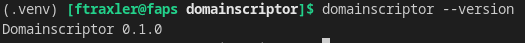

# DomainScriptor

[](LICENSE.txt)
[](https://www.python.org/)
[]()

> A CLI framework that unifies selected Active Directory pentest tools behind a single shell — automating checks, normalizing results into one central database, and adding AI-assisted analysis and command suggestions.



---

## ⚠️ Authorized use only

DomainScriptor is offensive security tooling for Active Directory assessments. Use it **only** against systems you own or for which you have **explicit, written authorization** to test. Unauthorized use against networks you do not control is illegal in most jurisdictions. The author accepts no liability for misuse or for any damage resulting from the use of this software.

---

## Features

- **Unified shell** over 11 AD pentest tools, each wired in through its own pluggable adapter.
- **Auto-detection** of installed binaries — missing tools are disabled automatically (see `showadapters`).
- **Normalized data** — every result is logged raw *and* mapped into one SQLite database (`hosts` / `findings` / `credentials`), deduplicated and severity-rated.
- **Prioritized findings view** plus report export to Markdown, HTML, or JSON (optionally with AI analysis).
- **AI assistant** (OpenRouter / Anthropic / OpenAI) for concrete next-step suggestions and vulnerability analysis of collected findings.
- **Guided check sequences** — full SMB (11 checks) and LDAP (10 checks) security sweeps, SMB credential hunting, share-visibility diffing, and BloodHound collection.
- **Web UI** for browsing collected data.

---

## Supported tools

Each tool is wired in through its own adapter and auto-detected at startup (if the binary is missing, the adapter is disabled — see `showadapters`).

| Adapter name | Tool / binary |
|--------------|----------------|
| `responder` | Responder |
| `smbexec` | impacket-smbexec |
| `smbclient` | smbclient |
| `ntlmrelayx` | impacket-ntlmrelayx |
| `nxc` | NetExec (nxc) |
| `proxychains` | proxychains4 |
| `nmap` | nmap |
| `nslookup` | nslookup |
| `bloodhound-ce` | bloodhound-ce-python |
| `kerbrute` | kerbrute (user enum / password spray) |
| `secretsdump` | impacket-secretsdump (NTLM hashes / Kerberos keys) |

---

## Requirements

- **Python 3.11+**
- **Linux** — built and tested on Kali.
- **Root privileges** — DomainScriptor re-executes itself via `sudo` on start (needed by Responder/ntlmrelayx and raw sockets).
- The **external binaries** listed above, per the adapters you intend to use. Anything not installed is simply disabled.

---

## Contents

- [Features](#features)
- [Supported tools](#supported-tools)
- [Requirements](#requirements)
- [Installation](#installation)
- [Quick start](#quick-start)
- [Configuration](#configuration)
  - [Tool configuration](#tool-configuration)
  - [AI setup (.env)](#ai-setup-env)
  - [Config file (TOML)](#config-file-toml)
  - [Report export](#report-export)
- [Commands](#commands)
- [Shortcuts](#shortcuts)
- [AI assistant](#ai-assistant)
- [Examples](#examples)
- [Contributing](#contributing)
- [License](#license)

---

## Installation

```bash
python -m venv .venv
source .venv/bin/activate
pip install -e .
```

---

## Quick start

```bash
domainscriptor start          # launches the interactive shell (re-execs as root via sudo)
```

On first launch you are prompted for optional initial credentials, a target IP range, and a database name. From there, a typical first pass looks like:

```
shortcuts smb_check           # run the full SMB security sweep against a target
fetch findings                # review prioritized findings
ai analyze                    # (optional) AI analysis of what was found
report html                   # export a standalone HTML report
```

---

## Configuration

### Tool configuration

For Responder and ntlmrelayx, adjust the following before first use.

**`/etc/responder/Responder.conf`** — disable SMB and HTTP so ntlmrelayx can use those ports:

```ini
SMB  = Off
HTTP = Off
```

**`/etc/proxychains4.conf`** — set the SOCKS proxy port to 1080:

```ini
socks4  127.0.0.1 1080
```

### AI setup (.env)

DomainScriptor supports three AI providers for the built-in assistant. A `.env` file in the working directory is enough — no need to export environment variables.

```ini
# Select the active provider: openrouter | anthropic | openai
AI_PROVIDER=openrouter

# OpenRouter (default provider)
OPENROUTER_API_KEY=sk-or-...
# OPENROUTER_MODEL=anthropic/claude-haiku-4-5   # optional, this is the default

# Anthropic
# ANTHROPIC_API_KEY=sk-ant-...
# ANTHROPIC_MODEL=claude-haiku-4-5-20251001     # optional, this is the default

# OpenAI
# OPENAI_API_KEY=sk-...
# OPENAI_MODEL=gpt-4o-mini                       # optional, this is the default
```

> Manually set environment variables always take precedence over the `.env` file.

### Config file (TOML)

Output paths, the web UI, the AI provider, and tool settings can be managed centrally through a TOML file. Generate a sample with:

```bash
domainscriptor config init          # writes ./domainscriptor.toml
domainscriptor config show          # prints the effective, loaded configuration
```

Lookup order: `DOMAINSCRIPTOR_CONFIG` (path) → `./domainscriptor.toml` → `~/.config/domainscriptor/config.toml`.

```toml
[paths]
work_dir       = "."        # base for targets.txt, loot/, reports/, ...
db_dir         = "."
loot_dir       = "loot"
report_dir     = "reports"

[web]
enabled = true
host    = "127.0.0.1"
port    = 5000

[ai]
provider = "openrouter"      # openrouter | anthropic | openai
model    = ""                 # empty = provider default

[tools]
responder_log   = "/usr/share/responder/logs/Responder-Session.log"
default_timeout = 300
detach_key      = "ctrl-g"          # key to detach a running job into the background (not Ctrl-Z)
pager           = "less -R"         # pager for long output / mouse-wheel scrollback ("" to disable)
```

> **Detaching a running job:** while a foreground command streams its output, press
> the configured `detach_key` (default **Ctrl-G**) to send it to the background and
> return to the prompt (`reattach <job>` to attach again). Ctrl-Z is intentionally
> *not* used so it stays free for shell job control and tmux/screen prefixes.
>
> **Scrolling long output:** `fetch`, `showoutput` and the share/loot/diff shortcuts
> pipe large output through the pager, so you can scroll with the mouse wheel and
> search it. Set `pager = ""` to disable.

> Priority order: defaults < TOML file < environment variables.
> Because DomainScriptor escalates to root via `sudo`, the project-local
> `./domainscriptor.toml` (or `DOMAINSCRIPTOR_CONFIG`) is more reliable than `~/.config`.

### Report export

Collected findings can be exported as a report at any time:

```
report                      → Markdown report into reports/ (timestamped name)
report html                 → HTML report (dark theme, standalone file)
report json out.json        → JSON export to a custom path
report markdown --ai        → Markdown including AI analysis of the findings
```

---

## Commands

All commands run inside the interactive shell (`domainscriptor start`). Tab completion is available.

| Command | Description |
|--------|-------------|
| `help [adapter]` | General help, or adapter-specific help |
| `version [adapter]` | Version of DomainScriptor or an adapter |
| `showadapters` | Show all registered and available adapters |
| `showprocesses` | Show running background processes |
| `stopprocess <name>` | Stop a background process |
| `runcommand <adapter> [param=value ...]` | Run a command through a specific adapter |
| `fetch [byIp\|byProtocol\|byToolname\|search] [value]` | Retrieve data from the database |
| `settings [add\|delete <id>\|default <id>]` | Manage credentials |
| `targets` | Show configured target IPs |
| `relayable` | Show relayable hosts from `smb_relayable.txt` |
| `shortcuts <shortcut> [proxy]` | Run predefined command sequences |
| `ai <suggest\|analyze>` | AI assistant: suggestions or vulnerability analysis |
| `report [markdown\|html\|json] [path] [--ai]` | Export findings as a report (optionally with AI analysis) |
| `config [show\|init]` | Show effective config or write a sample config |

### fetch

Reads normalized results from the SQLite database.

```
fetch                        → all raw entries (canonical_data)
fetch byIp 192.168.0.1       → filter by IP
fetch byProtocol SMB         → filter by protocol
fetch byToolname nxc         → filter by tool
fetch search zerologon       → full-text search
fetch hosts                  → discovered hosts (IP, hostname, OS, domain)
fetch findings [severity]    → prioritized findings (optionally filtered by severity)
fetch creds                  → found / recovered credentials
```

### Data model

Every result is stored raw as JSON in `canonical_data` (audit log) **and** additionally mapped into normalized tables:

- **`hosts`** — unique per host (IP/hostname), with OS and domain, deduplicated.
- **`findings`** — categorized (`RECON`/`VULN`/`MISCONFIG`/`CRED`/`SHARE`/`AD`) and rated by severity (`info`…`critical`); deduplicated per (host, tool, protocol, title).
- **`credentials`** — recovered secrets (`password`/`nt_hash`/`aes_key`/…) with source and host.

This structure feeds the prioritized `fetch findings` view, the report export, and the AI analysis. Existing databases are migrated automatically on startup.

### settings

Stores credentials for automated checks (domain, user, password).

```
settings                     → show current entries
settings add                 → add a new entry
settings delete <id>         → delete an entry
settings default <id>        → set an entry as the default for automated checks
```

If multiple entries exist and no default is set explicitly, the first entry is used. The active default is marked with `*` in the `settings` output.

---

## Shortcuts

Predefined command sequences for common checks.

| Shortcut | Description |
|----------|-------------|
| `shortcuts get_relayable` | Which hosts are SMB-relayable? → `smb_relayable.txt` |
| `shortcuts get_dc` | Find domain controllers → `dc_ips.txt` (via nxc or nslookup fallback) |
| `shortcuts smb_check [proxy]` | Full SMB security check (11 checks). At the IP prompt you can enter `all` to test every target in `targets.txt` |
| `shortcuts ldap_check [proxy]` | Full LDAP security check (10 checks). At the IP prompt you can enter `all` to test every target in `targets.txt` |
| `shortcuts list_shares` | List a host's SMB shares (colored, readable) and store them as a dedicated `SMB-SHARES` entry. At the prompt enter `all` for every target in `targets.txt` |
| `shortcuts hunt_creds` | Search SMB shares for credential-bearing files and download them. If only administrative shares (`C$`, `F$`, `ADMIN$`, ...) are visible it offers to scan those too. At the prompt enter `all` for every target in `targets.txt` |
| `shortcuts diff_shares` | Compare share/file visibility between stored users. At the prompt enter `all` for every target in `targets.txt` |
| `shortcuts collect_ad` | Collect AD data via bloodhound-ce-python (computers, users, groups, GPOs, ...) |

`smb_check` and `ldap_check` run the checks structured with headers:

```
━━━━━━━━━━━━━━━━━━━━━━━━━━━━━━━━━━━━━━━━━━━━━━━━━━━━━━━━━━━━
 [1/11] [SMB] Zerologon  (no auth)
━━━━━━━━━━━━━━━━━━━━━━━━━━━━━━━━━━━━━━━━━━━━━━━━━━━━━━━━━━━━
...
━━━━━━━━━━━━━━━━━━━━━━━━━━━━━━━━━━━━━━━━━━━━━━━━━━━━━━━━━━━━
 SMB scan complete — 11 checks run against 192.168.1.5
━━━━━━━━━━━━━━━━━━━━━━━━━━━━━━━━━━━━━━━━━━━━━━━━━━━━━━━━━━━━
```

**SMB checks:** Zerologon, NoPAC, PrintNightmare, SMBGhost, NTLM reflection, GPP autologin, GPP password, password policy, Coerce+, null session, guest logon

**LDAP checks:** AS-REP roasting, user descriptions, user passwords, Unix passwords, ADCS, domain trusts, LAPS, LDAP signing, machine account quota

---

## AI assistant

Requires a configured provider in `.env` (see [AI setup](#ai-setup-env)).

```
ai suggest      → the AI suggests concrete next DomainScriptor commands
ai analyze      → the AI analyzes all DB findings for weaknesses and attack paths
```

The AI receives as context: the available adapters, the findings collected in the DB, and the configured target domain.

---

## Examples

**List an SMB share**
```
runcommand smbclient target=192.168.1.10 share=SYSVOL username=user password=pass command=ls
```

**Check LDAP signing**
```
runcommand nxc protocol=ldap target=192.168.1.5 module=ldap-checker
```

**Start Responder**
```
runcommand responder interface=eth0 extra_args=-w
```

**Start ntlmrelayx**
```
runcommand ntlmrelayx target_file=smb_relayable.txt
```

**Determine relayable hosts and run an SMB check directly**
```
shortcuts get_relayable
shortcuts smb_check
```

**Find domain controllers (with nslookup fallback)**
```
shortcuts get_dc
```

**Nmap scan**
```
runcommand nmap target=192.168.1.0/24 ports=445,389,88 service_detection=true
```

**AI analysis after a scan**
```
shortcuts smb_check
ai analyze
```

---

## Contributing

Contributions are welcome. To set up a dev environment:

```bash
pip install -e ".[dev]"
pytest            # run the test suite
ruff check .      # lint
```

New tools are added as adapters under `src/domainscriptor/adapters_registry/adapters/` — see the existing adapters and `abstract_adapter.py` for the expected interface. Please keep parsing changes covered by tests in `tests/`.

---

## License

Released under the [MIT License](LICENSE.txt).

---

*by Fabian Traxler*
